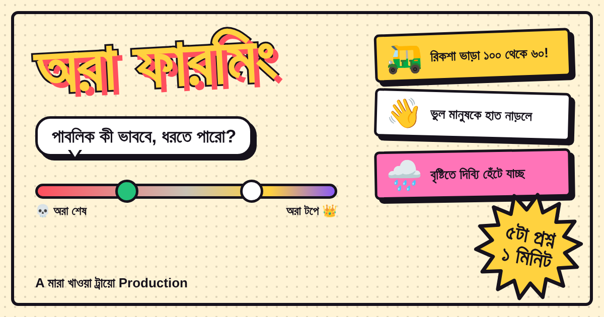

# অরা ফারমিং — Aura Farming 👑

> **পাবলিক কী ভাববে, ধরতে পারো?**
> A rapid-fire Bengali "vibe-reading" game for Bangladeshi Gen Z. Guess how much aura a situation gains or loses, see how close you got to the crowd, and share your aura card.

**▶ Play now:** [aura-farming-gamma.vercel.app](https://aura-farming-gamma.vercel.app)



---

## How it works

1. **5 situations, about 1 minute.** Everyday Bangladeshi moments: bargaining with a rickshaw mama, load-shedding calm, Eid relatives asking "রেজাল্ট কেমন? বিয়ে কবে?", liking your crush's three-year-old photo by mistake…
2. **Slide to guess** the aura, from **−10,000 (অরা একদম শেষ)** to **+10,000 (অরা একদম টপে)**, then lock in your answer.
3. **Instant reveal:** your guess against the public average, a comic sound-effect burst, points, and a one-line roast.
4. **Final result:** your persona (from 👑 অরার বাদশা to 💀 অরা একদম শেষ), a result meme, and your best and worst guess.

**Scoring:** `max(0, 1000 − |your guess − public average| / 10)` per round, up to **5,000** in total.

## Features

- 🇧🇩 Fully Bengali interface with Bengali numerals
- 🎴 34 hand-written, locally relevant scenarios
- 💥 Comic-strip design: ink outlines, halftone dots, starbursts and speech bubbles
- 🌗 Light and dark theme (follows your phone's setting, or switch it yourself)
- 🖼️ Shareable result card with a meme, exported as an image for stories
- ⚔️ **Friend duel:** send a link and your friend plays the same 5 cards to beat your score
- 🔥 Daily streak
- 📲 Facebook share, plus a rich link preview for Messenger and WhatsApp

## Tech

- **One file:** `index.html` (HTML + CSS + vanilla JS). No framework, no build step, no backend.
- **Libraries:** [html2canvas](https://html2canvas.hertzen.com/) for the share image, and Google Fonts *Atma* and *Hind Siliguri*.
- **Storage:** only `localStorage` on the player's device (theme, streak, name).
- **Hosting:** GitHub + Vercel. Every commit to `main` deploys automatically.

```
├── index.html     # the whole game
├── og-image.png   # 1200×630 link-preview banner
└── README.md
```

## Run locally

Open `index.html` in a browser. Nothing to install.

## Editing text & scenarios

All wording sits in one block in `index.html`, between `/*TEXT-START*/` and `/*TEXT-END*/`:

| Name | What it holds |
|---|---|
| `T` | UI text |
| `S` | Scenarios: emoji, public average, text, reveal line |
| `PERSONAS` | Result ranks |
| `MEMES` | Result memes (add `img: "memes/file.jpg"` to use your own picture) |

When adding a scenario, give it the next free `id` and never renumber existing ones, because duel links depend on them.

## Roadmap

- Real public averages from player data
- Weekly themed packs (Eid, cricket, admission season…)
- Player-submitted moments, reviewed before they go live

## Disclaimer

Just for fun. The "public averages" are currently estimates, not survey data.

---

**A মারা খাওয়া ট্রায়ো Production** • বাংলাদেশে বানানো 🇧🇩
